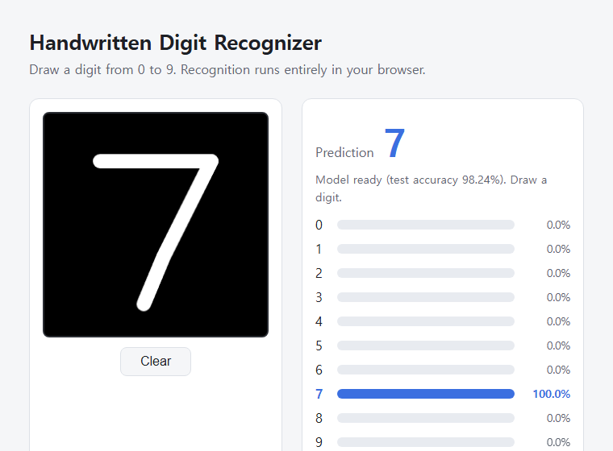

# Handwritten Digit Recognizer

마우스나 손가락으로 숫자(0~9)를 그리면 신경망이 인식하는 프로그램입니다.
웹 버전은 서버 없이 **브라우저 안에서** 인식합니다.

**▶ Live Demo: https://soohyun12-by.github.io/handwritten-digit-recognizer/**



## 특징

- MNIST 70,000장으로 학습한 MLP 신경망 (784 → 256 → 128 → 10), 테스트 정확도 **98.24%**
- 웹 버전: 순수 HTML/CSS/JavaScript, 외부 라이브러리 없음, GitHub Pages로 호스팅
- 마우스 / 터치 / 펜 입력 지원, 모바일 화면 대응, 다크 모드 지원
- 한 획을 그릴 때마다 실시간 인식, 0~9 전체 확률 막대그래프 표시
- 데스크톱 버전(tkinter)도 함께 제공

## 동작 방식

```
[Python] train_model.py  → MNIST 학습 → digit_model.joblib
[Python] export_model.py → 가중치 추출 → docs/model.json
[Browser] 캔버스에 그리기 → preprocess.js (28x28 변환) → model.js (신경망 계산) → 결과 표시
```

전처리는 MNIST 형식에 맞추기 위해 다음 순서로 진행합니다.

1. 숫자가 그려진 영역만 잘라내기
2. 비율을 유지하며 긴 변을 20px로 축소
3. 28x28 이미지 중앙에 배치
4. 무게중심을 이미지 중앙으로 이동

## 폴더 구조

```
├── train_model.py         # MNIST 다운로드 및 모델 학습
├── export_model.py        # 학습된 모델 → docs/model.json 변환
├── digit_recognizer.py    # 데스크톱(tkinter) 버전
├── requirements.txt
└── docs/                  # 웹 버전 (GitHub Pages)
    ├── index.html
    ├── style.css
    ├── app.js             # 그리기, 결과 표시
    ├── preprocess.js      # 이미지 전처리
    ├── model.js           # 신경망 계산
    ├── model.json         # 학습된 가중치
    ├── test.html          # JS 구현 검증 페이지
    └── test_samples.json  # 검증용 샘플 (Python 계산 결과 포함)
```

## 실행 방법

### 웹 버전 (로컬)

```bash
python -m http.server 8000 -d docs
```

브라우저에서 http://localhost:8000 을 엽니다.
`index.html`을 더블클릭해서 열면 보안 정책 때문에 동작하지 않으니 꼭 서버로 실행하세요.

검증 페이지(http://localhost:8000/test.html)에서 JS 계산이 Python과 같은지 확인할 수 있습니다.

### 데스크톱 버전

```bash
pip install -r requirements.txt
python digit_recognizer.py
```

처음 실행하면 MNIST를 내려받아 모델을 학습합니다(약 1분).

### 모델 다시 학습하기

```bash
python train_model.py    # 모델 학습
python export_model.py   # 웹 버전용 docs/model.json 갱신
```

## License

[MIT](LICENSE)
